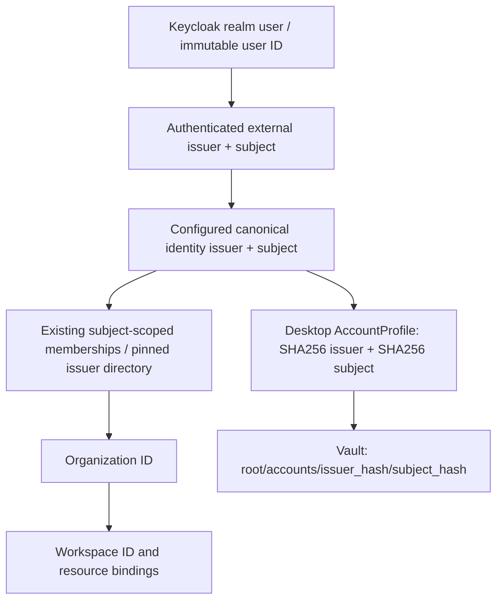

# Stable account identity and durable local root V1

Authority: MF-MAIN3-01-STABLE-IDENTITY-DURABLE-ROOT-20260913-13.
Integration examined read-only: `1ef95a71c5e7422cb3fe1435ccd703193629b591`.
No data migration or public issuer cutover is authorized by this ADR.

## Current graph (audit before implementation)

There is currently no independently allocated persistent MentorFlow account ID table.
The existing equivalent identity anchor is the canonical issuer namespace plus immutable
subject. `personal_scope()` derives personal organization/workspace IDs from that anchor;
existing memberships and resource IDs remain authoritative. Display username/email do not
own identity. `VaultLayout` already defaults to `E:/MentorFlowData`, but runtime overrides
can currently select disposable directories without proving durability.

## Decision

Reuse the existing immutable canonical anchor and expose a versioned deterministic
MentorFlow `account_id` derived from its two SHA-256 components. It is an account key,
not an authentication credential and not authorization to any tenant/workspace.
Keep existing Vault paths and organization/workspace IDs; do not rename directories or
allocate a second account merely to introduce the account-key projection.

For this exact deployment, localhost → auth.clannad.win is a same-authority hostname
migration **only with operator-authorized, authenticated, per-subject mapping**. The OLD
issuer string remains the immutable namespace anchor, not a hostname the client must
contact. External token/credential evidence still carries the actual issuer and subject.
No username/email match, hostname resemblance, or unverified client account_id can establish
continuity. Unmapped NEW subjects and unknown issuers fail closed.
Configuring the exact public E109 issuer without the OLD canonical anchor is rejected
at startup, including after the temporary token migration window ends. A hostname-only
configuration edit therefore cannot silently create a NEW account namespace.

Use a detached Ed25519 signature over a strict versioned mapping manifest. The signing key
is offline/operator-owned; the verification key and exact expected manifest digest come
from backend deployment configuration, not the manifest or request. The manifest identifies
its audit/change record and lists exact OLD/NEW issuer+subject pairs. This V1 permits only
the existing two E109 issuers and the same immutable subject under both. Entries are unique
and one-to-one; duplicate subjects/aliases, schema changes, tampering, wrong signer or wrong
digest are rejected. The `subjects` array encodes exact same-subject pairs (one OLD and
one NEW identity for each entry); V1 does not allow subject renaming. Authentication policy,
issuer allowlists, token signatures, audiences,
expiry, client and tenant membership checks are not broadened by this mapping.

The native verifier applies the map only after its existing mTLS identity response validation.
Downstream principals keep the canonical anchor, so the existing tenant directory, bootstrap,
resource scopes, Desktop profile and Vault address remain unchanged. The legacy JWT adapter
must enforce the same per-subject map when translating a different external issuer to the
canonical namespace. No production manifest or signing key is provisioned in this task.
Cross-issuer backchannel logout also requires a mapped subject; a sid-only event cannot
assert account continuity. Same-issuer logout retains its existing behavior.

Desktop's reused JWT verifier requests external identities, retaining actual token issuer
and subject. Before returning an `AccountIdentity`, Desktop requires the authenticated
Backend `/auth/me` account key to match the canonical anchor when issuers differ. Desktop
does not hold the operator signing key or provision its own alias map. The native session
response already represents the Backend-verified canonical identity.
Legacy OIDC refresh stores rotated credentials only after Backend confirms the account
anchor. If that confirmation fails after upstream rotation, reauthentication may be needed;
an unverified cross-issuer response is never written to a second Locker/Vault namespace.

## Durable storage policy

The formal default is `E:/MentorFlowData/accounts/<canonical issuer hash>/<subject hash>`.
A single resolver owns layout, root validation and readiness. Production account roots must
not be in Temp, installer staging, the source worktree or build/artifact directories, and
must reject symlink/reparse ancestry. Tests may explicitly select TEST_ONLY disposable roots;
they remain `TARGET_STORAGE_STABLE=NO` and cannot authorize real migration.
Existing accepted `%LOCALAPPDATA%/MentorFlow/Accounts/<device profile>` roots are retained by
the central resolver when present; new installations default to E:. Device profile names
are device configuration, never account identity. No directory is moved or renamed.

`desktop.account_storage` owns device-root selection, prelaunch paths, profile paths and
the migration gate. `VaultLayout` delegates to it. Both installed launch paths, packaged
sidecar, runtime, bootstrap and account switching use this boundary. Compiled UAT launch
sets `MENTORFLOW_ACCOUNT_STORAGE_TEST_ONLY=1`; direct tests use that explicit environment
or `VaultLayout(..., test_only=True)`. The returned target carries `test_only=True` and
`target_storage_stable=False`. Real import entry points default to `test_only=False`
regardless of the process environment. Disposable import tests must additionally pass
`test_only=True`; no product import caller does so.
An explicitly TEST_ONLY process cannot execute a real import even when a selected path
would otherwise be durable; its fixture marker never becomes a production readiness claim.
Old ad-hoc test launchers/sidecars that point at Temp without the TEST_ONLY marker now
fail closed. The package sidecar accepts an explicit `MENTORFLOW_ACCOUNT_STORAGE_TEST_ONLY`
value `0` or `1`; the owning harness must declare its fixture mode. This task does not
modify worker 02's workbench/harness or repackage the currently running candidate.

All account mount/bootstrap/switch paths use the resolver. Migration entry points must
consult it before creating staging or copying bytes; unstable storage or a target belonging
to a different profile is rejected. This does not implement Portable Pack V2 or server sync.

## Readiness interpretation

Source/fixture proof does not attest the currently running Temp candidate as durable, nor
does it authorize a real issuer switch. The current user's Temp Vault remains an unstable
target. Its future continuity proof must bind the already verified subject evidence to the
same canonical account under an approved mapping; a username-only claim is insufficient.
The final receipt separates implemented contract/fixture results from current live gates.

## Future deployment prerequisites (not executed)

1. Inventory authenticated OLD realm subjects and attest that the public endpoint represents
   the same realm/database and unchanged immutable user IDs. A username/email match is not
   evidence. Record the operator/change authority in `audit_id`.
2. Produce a strict UTF-8 JSON document with exactly `schema`, `audit_id`, `old_issuer`,
   `new_issuer`, `subjects`. Schema is `mentorflow.identity-continuity.v1`; issuer values
   are the exact E109 pair. Sign the exact bytes with an operator-owned Ed25519 key.
   Protect the file and deployment configuration from application users. Keep the private
   key outside Backend/Desktop. This task generates no deployable approval/key/manifest.
3. Configure all four Backend trust inputs together:
   `MENTORFLOW_IDENTITY_CONTINUITY_FILE`,
   `MENTORFLOW_IDENTITY_CONTINUITY_SIGNATURE_HEX`,
   `MENTORFLOW_IDENTITY_CONTINUITY_PUBLIC_KEY_HEX`,
   `MENTORFLOW_IDENTITY_CONTINUITY_SHA256`. Pin the digest/key outside the document;
   retain the signed document and audit record. Replacement/revocation requires reviewed
   deployment inputs and Backend restart (existing process-local sessions then expire).
4. Deploy compatible Backend/Desktop before a separately authorized hostname cutover.
   `MENTORFLOW_NATIVE_EXTERNAL_ISSUER` selects the real mTLS verifier response issuer;
   absent means the canonical issuer, preserving current OLD operation. Only configure
   NEW when the actual identity authority reports NEW. Keep the canonical identity issuer
   OLD. The E109 token allowlist, bounded window and API authority are separate controls;
   this manifest neither starts a window nor makes an unaccepted JWT issuer acceptable.
5. For the authenticated account, select a durable device root, resolve its expected Vault,
   and verify `target_storage_stable=True`, `test_only=False` and the server account key.
   A Temp candidate must not be promoted by renaming a readiness flag. UX/import orchestration
   must select the configured canonical target, not an arbitrary empty folder. Existing
   legacy local archives cannot import directly into the enterprise `accounts` namespace.
6. Only a later expressly authorized executor may migrate data after the above gates and
   the accepted cross-device continuity gates pass. Recheck wrong-account and replay cases.
   No user-data migration, identity mutation, public cutover, SMTP or capability opening
   is performed by this source change.

## Limits

This is a versioned projection of the accepted canonical anchor, not a new account database
or a grant to a tenant. New public subjects also require explicit enrollment in the signed
map; automatic cross-realm linking and subject-ID changes are out of scope. Filesystem
readiness proves configured location and link constraints, not hardware longevity, backups,
disk access rights or completion of a future data import. Existing importer protections
continue to validate and pin filesystem ancestry during publication.
