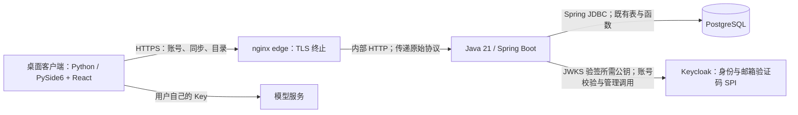

# MentorFlow：把账号与同步后端从 Python 改成 Java

面试讲解稿：实现细节和测量数据是注明日期的历史证据；当前发布与恢复状态以 [ARCH-09]、[ACC-02]、[SYS-06] 为准。本文代码出处已按当前基线复核；下面的第一人称是讲述模板，面试时按自己的实际参与范围调整。本次只整理文档，没有重新压测，也没有操作服务器。[S1]

## 一分钟项目介绍

> MentorFlow 是一个 AI 教师桌面软件，用户选资料、建学习计划，再跟着老师学习和练习。桌面端负责课堂、模型调用和本地数据，服务器主要管账号、设备会话、多设备数据同步，以及资料白名单和价格目录。
>
> 我们原来用 Python FastAPI 做服务器，这次把边界比较清楚的账号和同步业务逐块迁到 Java 21、Spring Boot。改造也服务于 Java + AI 的学习和求职实践，AI 提示词和课堂编排继续留在 Python，模型仍由客户端用用户自己的 Key 直连。
>
> 最费心的是兼容已有客户端和数据。我用同一组 HTTP 请求分别测 Python 和 Java，比较响应和数据库结果，连错误码、中文文案和 JSON 顺序都检查。历史切换先影子运行，再把相关接口整组切过去；Python 回退路径和当前备用版本，以 [ARCH-09] 为准。切换时踩过一个反向代理协议识别的坑，后来补了真实客户端经过代理的回归测试。[S1][S2][S3][S7][S8]

如果只剩一句话：**我做的是有存量数据和客户端的兼容迁移，重点是会话连续性、并发写入、失败恢复，以及可验证的切换。**[S3][S4][S7]

## 架构：先把请求怎么走讲清楚

服务器内部按 `identity`、`account`、`sync`、`closure`、`admin`、`catalog`、`health` 分包，仍是一个 Spring Boot 应用。PostgreSQL 沿用既有表和 Alembic 迁移链，Java 服务不自行建表、不自动迁移。Spring JDBC 直接调用既有 SQL 和注销函数，没有换成 JPA，也没有把 Python 服务当 Java 的代理后台。[C1][C3][C4][S4]

注意两种令牌：Keycloak JWT 由资源服务器验证；桌面常用的 `mfn1_a_` 是随机的不透明原生访问令牌，走本进程会话验证，并不是把它当 JWT 解码。邮箱验证码继续由 Keycloak SPI 负责，Java 后端转交和确认，没有再另做一套发信算法。[S2][S3][S5][C2]

## 技术要点：做了什么，为什么，踩了什么坑

### 1. Spring Boot 和 Spring Security：验签之后还要查权限

可以这样讲：

> Spring Boot 帮我把 Web、配置、数据库连接和各业务模块装配起来。认证入口用 Spring Security Resource Server，Keycloak 的 RS256 签名交给 Nimbus 校验，再按原 Python 的顺序检查 issuer、audience、时间和主体等声明。身份通过之后，还要查数据库里的组织、工作区成员和账号状态，不能直接相信令牌自报的角色。[S2][C1][C2]

管理概览也重新读取成员关系，并按服务端管理员名单判断权限，不接受客户端自称管理员。[S6]

为什么这么做：要保留原来的身份边界和错误合同，而不只是“JWT 能验签”。JWT 有效，不代表用户属于请求里的工作区。数据库侧还沿用原有应用角色和 RLS；同步事务绑定 issuer、subject、organization、workspace 的作用域。[S2][S4][C3]

踩过的坑：两种语言的异常投影不一样。坏 JSON 即使都返回 422，错误位置和文本仍可能不同；后续用保存的请求向量修正诊断映射。JWT 路径通过，也不代表原生令牌和浏览器 cookie 能互通。[S3][S7]

### 2. 原生会话：短访问令牌、刷新令牌族与重放检测

可以这样讲：

> 访问令牌有效期最多 300 秒，刷新令牌负责换一对新令牌。数据库只保存刷新摘要和已用摘要等状态，不保存刷新令牌明文。刷新成功后，旧摘要进已用集合；如果旧刷新令牌再来，就视为重放，撤销整个会话族；接口对客户端返回需要重新认证的错误，不能把数据库撤销原因当作响应码。这个项目把刷新族 TTL 配成 0 时可以长期接续，但退出、重放、改密绑定和撤销仍然会让它失效。[S3][C2]

为什么这么做：把短期访问和长期接续分开；后端重启后可以通过数据库里的刷新族恢复。同一原生会话实现里，新登录会撤销该主体的旧会话族并标记 `NATIVE_SESSION_SUPERSEDED`，旧 access/refresh 返回专门的 401；客户端收到该码会停止同步和上课，未上传数据保留在本机。跨 Python/Java 的 access 互认仍是下文说明的边界。[S1][S3][C2]

并发怎么管：同一主体登录使用 PostgreSQL advisory transaction lock，进程内还有发布锁，避免旧结果覆盖新缓存。访问缓存与当前刷新摘要绑定；数据库中族已撤销或刷新已轮换，旧访问凭证就不能继续当成有效会话。[S3][C2]

踩过的坑：刷新族在数据库，访问摘要却在各自进程内存。Python 签发的短期 access，Java 不认识；有效 Python 浏览器 cookie 也不能直接搬过来。不能说“用了同一个数据库，所以所有会话天然共享”。这也是最后必须整组切换的原因。[S3][S7]

### 3. 同步：乐观锁解决并发，幂等解决重试

可以这样讲：

> 客户端上传时带 `expected_revision`。服务端发现当前版本不一致，就返回 409，让客户端先拉远端再处理。另一个字段 `request_id` 解决“服务器已经写成功，但响应丢了”的情况：同一个请求 ID、同一个内容，直接返回原回执；同一个 ID 换内容则拒绝。[S4][C3]

这里有两个不同问题：CAS 防止两个修改互相覆盖；幂等防止一个修改因重试执行多次。幂等键按 issuer、subject、organization、workspace 和 request_id 查找。实现先查幂等回执，再做版本比较，因此成功后的原请求重试不会因为版本已经加一而误报冲突。摘要覆盖记录类型、实体 ID、期望版本、删除标记和载荷。[S4][C3]

并发验证不是让某个请求故意晚到：两端各跑 50 轮，每轮两个线程同时用同一个版本写同一条记录，每轮一个 200、一个 409，最终 revision 为 50。服务端没有替用户自动合并冲突；合并决定在客户端。[S4]

拉取方面沿用 `/changes` 的变化序号和游标分页，删除保留墓碑；`/snapshot` 仍兼容。查询始终限定账号和空间，不能把别人的变化序号或记录混进本人的结果。[S4][C3]

### 4. 批量写入：一个外层事务，每条一个保存点

可以这样讲：

> 批量接口里，版本冲突或单条格式错误是可以逐条报告的业务结果。我用一个外层事务，每条通过 Spring 的 `PROPAGATION_NESTED` 建保存点。逐行捕获的 SyncFailure 只回滚到这一条的保存点，其他条继续；数据库故障或未捕获异常则让外层事务整体回滚。外层真正提交后才返回成功。[S4][C3]

为什么这么做：减少逐条 HTTP 往返，同时保留已有的部分成功语义。保存点不是另开一个独立提交的事务；后面外层失败，前面已经通过保存点的写入也没有提交。测试故意让后一条触发未捕获错误，再读快照确认前一条也没留下。[S4][C3]

踩过的坑：序列化也影响兼容。回执摘要使用的规范化 JSON、数据库载荷文本的转义和空格，都需要按原合同处理；只比较解析后的业务对象会漏掉这些差别。[S4]

### 5. HTTP 413：客户端拆批，不让大请求一直原样重试

可以这样讲：

> BUG-97 记录的 2.0.14 线上故障中，用户积压的待同步批次被当时 nginx 批量入口的大小配置拒绝，每次重试仍是同一大包，所以一直失败。服务器修正批量路由的大小配置，客户端也补了 413 对半拆批。拆小以后每条保留原来的 request_id 和 expected_revision，成功的子批立即确认；单条仍然过大就只把那条留待处理，其他记录继续。[S1][C5]

这是既有客户端修复，Java 迁移沿用它，不是 Java 新增了自动拆批。413 的网关限制和单条载荷限制也不是一回事：145 本机直连两版应用的测试表明，nginx 的 9 MiB 限额不等于应用里也有同样的整包拦截。拆批不能保证超大的单条最终成功，认证错误也不能靠拆批绕过。[S1][S4][C5]

### 6. 注销：两步确认、持久化检查点、可重试恢复

可以这样讲：

> 第一步重新核对当前密码，生成注销操作编号和恢复凭证，只准备，不删除。第二步用户明确确认后，拿这个凭证提交原操作。即使登录令牌在过程中被撤销，仍能查询同一操作，失败后也能继续，不需要再造一次删除。[S6][C4]

数据库清理仍调用现有 PostgreSQL `account_closure` 函数，处理顺序和事务边界照搬；Keycloak 删除则按精确 subject 查询、删除、再查询确认。它们跨两个系统，不能靠一个 JDBC 事务实现整体原子提交。[S6][C4]

中途 Keycloak 失败时，本地清理可能已经提交。正确做法是持久化 `RETRYABLE_FAILURE` 和 `data_cleaned`、`identity_deleted` 检查点，保持账号写入围栏，返回未完成；原操作重试后继续到完成。不能把“有恢复机制”讲成“所有失败都自动回到删除之前”。[S6][C4]

踩过的坑：147 的默认注销还缺共享限流与会话撤销接线，步骤间检查也不能及时停止阻塞调用。148 已补生产 adapter、期限中断和取消传播：真正阻塞的 provider 在缩短测试尺度下与 Python 结果一致。但这不等于证明任意 TCP 断连都会被 Servlet 转成线程中断。现行 PREPARED 没有独立 TTL，120 秒是执行租约，二者不要混讲。[S6][S7][C4]

### 7. 契约测试：不只“都返回 200”

可以这样讲：

> 我把请求流程写成同一套测试，对真实启动的 Python 和 Java 各跑一遍。比较状态码、应用响应头、原始 UTF-8 正文，再比较执行后的数据库行。令牌、随机操作 ID 和数据库时间本来就不同，要先检查格式，再按明确规则归一化；其他字段不随便忽略。[S2][S3][S4][S6]

同步比较实体、幂等回执、初始化清单；注销比较成员关系、同步数据、注销操作和会话族等表。并发赢家本来不确定，不能强行要求两个实现选中同一个 request_id。真实 PostgreSQL 和应用角色用于验证事务/RLS；Keycloak 是本机 HTTPS 替身，因此这些测试不冒充线上真实验证码邮件验收。[S4][S5][S6]

踩过的坑：早期测试把 HTTP 拼对了，却绕过了生产代理链。149 换成真实 `NativeCredentialClient`、`LoginSession`、`SyncTransport`、`ClosureClient` 走本机代理拓扑，才覆盖了登录恢复与后续同步的组合。[S8]

### 8. 整组切换与回滚：路由回退不等于数据倒带

可以这样讲：

> 先让 Java 在旁边影子运行，确认配置、健康和请求对照，再整组切受保护的账号和同步接口。访问摘要在进程内存，不能登录落 Python、下一次同步随机落 Java。刷新族和业务记录共用 PostgreSQL，切换时通过 refresh 接续，但旧短期 access 不会凭空互认。[S3][S7]

当前已验证的恢复路径是先以 `--prepare-only` 启动 Python 226 备用并等待健康，再做内部契约 probe；只有具体授权切流后，才切入口到 Python。异常时不得靠覆盖数据库备份回滚，数据库维持 0046；Java/Python 219 都不兼容该结构。任何准备、切流与回切操作按 [ARCH-09] 和 RELEASE226 执行。[S7][C6]

历史验收记录：2026-10-16 15:16 修复后再次整组切到 Java，用户先关软件，重开 2.0.20 后确认自动登录、同步、上课正常；记录中的随后 20 分钟，refresh/session/me/workspaces/changes/bulk 都为 200，Java 内存约 200 MB。上述是当时的观察，不代表当前版本或当前回退状态。当前发布、备用版本及恢复边界见 [ARCH-09][ACC-02][SYS-06]；当时注册、找回、改密、改邮箱、注销尚无线上真人完整验证，这一历史缺口不能直接当作当前结论。[S1]

### 9. 线上踩坑：客户端是 HTTPS，后端却看见 HTTP

可以这样讲：

> TLS 在 nginx 结束，nginx 到 Java 走内部 HTTP。原生认证要求 HTTPS，Java 当时没恢复转发头里的原始协议，于是 request.scheme 是 http，控制器回 403 NATIVE_TRANSPORT_REQUIRED。客户端把这个未识别错误映射成 NATIVE_AUTH_UNAVAILABLE，看上去像账号服务挂了。[S8]

为什么本机没发现：148 直接连测试 Java HTTPS，没有经过“客户端 HTTPS → edge TLS 终止 → HTTP upstream”，而无有效凭证的对照也不能证明登录和刷新正常。149 用旧 JAR 和真实客户端在本机复现了两条失败路径。[S8]

修法是正式配置 `server.forward-headers-strategy=framework`，让 Spring 在业务检查前恢复协议，保留原来的 HTTPS 检查。回归还验证了没有转发标记的直接 HTTP 仍被拒绝，并加上方法、路由模板、状态码、耗时的访问日志，不记录密码和令牌。[S8][C7]

证据边界要说清：当时线上没有保存原始响应状态和转发头，不能说“我从线上日志直接看到了这条 403”。准确说法是：代码、保存配置和客户端现象支持这一机制，本机修前复现、修后通过，随后线上重切成功。更新下载失败的独立原因没有查实，也不把时间相邻当因果。[S1][S8]

## 能引用的数据：先说场景，再报数字

### 范围与测试

| 数据 | 原报告口径与限制 | 出处 |
|---|---|---|
| 服务器原范围约 1.6 万行、38 个接口 | 沿用 ARCH-09/146 回执的存量路由盘点数，没有在本次重算业务路径。目录 2 个、同步 5 个；147 有 3 个注销接口加概览 1 个业务路径，概览还映射 HEAD 并返回 405，不能把原盘点的“147 负责 5”当成 5 种业务。 | [S1][S4][S6] |
| 142：Python/Java 各 9 组 HTTP 合同 | 第一阶段身份、目录、健康；不能当全部账号功能覆盖。该阶段唯一全量为 4002 通过、1 失败、33 跳过，不写成全绿。 | [S2] |
| 145：50 组共享 HTTP 合同 | 每组对两端执行，性能是单独测量、该批全量未启用跑分；并发各 50 轮，每轮一成功一冲突。 | [S4] |
| 147：19 组双实现验证，另 1 项 Java 保护 | 包括 TLS 拒绝检查，不把握手错误正文称为逐字节一致；后续接线以 148 结果为准。 | [S6][S7] |
| 148：Java 子集 107 通过、2 跳过 | 同轮 Python 全量 4104 通过、34 跳过；跳过的是可选性能测量。不是新增 107 个接口。 | [S7] |
| 149：最后全量 4108 通过、34 跳过 | 0 失败/错误，63 warnings；pytest 原始汇总 2227.41 秒。是当批 tests/refactor 全套，包含客户端和服务端；不是 4108 个 Java 用例，也不与前批相加。 | [S8] |

### 性能对比

| 场景 | Python | Java | 怎么解释 |
|---|---:|---:|---|
| 142：每端 1000 次顺序小目录 GET，平均 HTTP 往返 | 5.529 ms | 3.865 ms | Windows 本机、JWT/小目录、外部成员状态替身；没有生产 PG/Keycloak、并发或容器限制。[S2] |
| 同一 142 场景：预热后空闲 RSS | 88.39 MiB | 201.52 MiB | Python 包括启动器和实际工作子进程，Java 用默认 JVM 参数。[S2] |
| 同一 142 场景：采样峰值 RSS | 89.53 MiB | 244.44 MiB | 是采样值，不是所有时间上的绝对峰值。[S2] |
| 145：每端 20 批，每批 100 条，平均请求耗时 | 597.680 ms | 491.563 ms | 本机 HTTP + PostgreSQL 17.6 真实提交，先 Python 后 Java；请求平均分别为 1,023,633 和 1,023,433 字节，非完全同字节。[S4] |
| 145：Java 性能轮结束工作集/峰值工作集 | 未给出同场景 Python 内存对照 | 385.57 / 407.99 MiB | Windows 进程指标，不能与上一行目录场景或 Linux 容器内存混算。[S4] |

面试答法：“这两组本机样本中 Java 平均延迟更低，但内存占用更高。它们证明功能之外也测过资源成本，不能证明所有业务 Java 都更快，也没有据此推导生产 QPS、P99 或可支持用户数。线上约 200 MB 是 2026-10-16 当时的运行观察，和 Windows RSS 不是同口径，也不是当前版本的内存测量。”[S1][S2][S4]

## 高频追问 15 个和答法

1. **为什么要从 Python 改 Java？**
   业务边界已经比较清楚，改造也服务于 Java + AI 的求职实践。我把账号、同步等业务迁到 Spring Boot，AI 提示词和课堂编排仍留 Python；不能拿两组本机样本声称 Python 撑不住。[S1][S2][S4]

2. **Spring Boot 在这里具体做了什么？**
   它装配 Web、Security 和数据库相关组件；业务按包分职责，用配置和 Bean 接上会话、目录与注销。持久层用 Spring JDBC/TransactionTemplate，沿用既有 SQL，没有用 JPA 自动改表。能讲到代码装配，不把它包装成微服务架构。[C1][C3][C4]

3. **Spring Security 不是配个 JWT 就完了吗？**
   验签只说明凭证可信。还要检查 issuer、audience、时间、主体和账号状态，再从数据库解析角色、组织、工作区。原生随机 access 另有验证路径，不是所有 Bearer 都是 JWT。[S2][S3][C2]

4. **JWT 无状态，怎么实现踢下线？**
   本产品桌面主要走原生会话族。新登录撤销旧族，access 验证读取族状态并核对刷新摘要，返回专用的 superseded 错误。不能把这说成对任意外部 Keycloak JWT 的同一种即时撤销方案。[S3][C2]

5. **刷新令牌被同时用两次会怎样？**
   成功刷新会轮换摘要，旧摘要进入已用集合。再次使用旧刷新令牌按重放撤销整族；并发不会被当成两个都合法的新会话。因此调用方要协调刷新，失败映射也区分临时不可用与明确失效。[S3][C2]

6. **你们的并发控制是不是只用 synchronized？**
   不是。会话登录和同步分别使用 PostgreSQL 事务级 advisory lock；进程锁管本地缓存发布。CAS 再检查版本，数据库作用域/RLS 管隔离。access 仍在进程内存，当前部署有单进程前提，不能宣称天然支持任意横向扩容。[S3][S4][C6]

7. **expected_revision 和 request_id 有什么区别？**
   前者判断“我修改的还是不是原来的版本”，后者判断“这次请求以前是否成功执行”。重试先查原回执，再查版本；复用同一请求 ID 却换内容会返回 409，而不是覆盖。[S4][C3]

8. **NESTED 和另开一个事务有什么区别？**
   本项目 JDBC 的 NESTED 是外层事务里的保存点，没有独立提交。单条业务失败可回到保存点继续；外层数据库异常会撤掉之前各条。代码用显式 TransactionTemplate，不靠同类内部调用去碰代理事务是否生效的问题。[C3][S4]

9. **为什么不用 JPA，为什么保留 RLS？**
   迁移目标是兼容既有表、SQL 和事务边界，JDBC 更直接。应用先验证身份和空间权限，事务再绑定作用域，数据库保留已有 RLS；测试用真实应用角色，避免超级用户绕过策略让测试假通过。[S4][C3]

10. **413 为什么不能直接多重试几次？**
    请求体不变就仍可能被同一入口拒绝。客户端对半拆，保留每条的幂等 ID 和期望版本；只有单条也失败时才单独留待处理。服务端已经成功、回执丢了的部分依靠幂等避免重复写。[S1][C5]

11. **注销失败为什么不把数据库回滚？**
    PostgreSQL 和 Keycloak 没有这个整体事务。数据库清理可能已提交，恢复靠持久化操作、检查点和写入围栏，继续确认精确用户已删除。返回可重试失败，不承诺未发生删除，也不伪报完成。[S6][C4]

12. **随机令牌和时间不同，怎么逐字节对照？**
    先验证这些非确定字段格式和必要关系，再按白名单归一化；其他正文保留原始 UTF-8、顺序和转义。数据库也比较指定业务列。传输层 Date/Server 等不伪称相同，HTTP 对照和行对照各有明确排除项。[S2][S3][S4][S6]

13. **测试都过，为什么上线还出问题？**
    测试范围漏了代理拓扑：本机直接 HTTPS，生产是 edge 终止 TLS 后转 HTTP。旧测试证明了直连合同，没有证明真实部署链；149 补真实客户端经过同样拓扑，固定修前失败和修后成功。[S8]

14. **为什么整组切换，回滚要恢复数据库吗？**
    短期 access 在各进程内存，分散路由会让有效用户被另一版拒绝。整组切，再靠共享刷新族恢复；Python 备用的已验证准备、健康检查、内部 probe 与授权切流步骤见 RELEASE226。恢复时保留当前数据库，不覆盖新会话轮换、同步结果和已完成注销。[S3][S7][C6]

15. **X-Forwarded-Proto 修复后，你怎么证明修到了？**
    旧配置下真实客户端经 TLS edge→HTTP Java 复现登录/刷新失败；正式 framework 配置下两端完整链通过，同时无转发标记的直接 HTTP 仍被拒绝。访问日志补路由模板、状态、耗时，不记录密码和令牌。线上历史原始响应缺失这个证据边界仍要承认。[S8][C7]

## “我能讲到多深”自查表

能不看稿回答右侧问题，再把这一项写进自己的项目介绍；答不上来就回到对应源码，而不是背名词。

| 要点 | 至少能讲到的深度 | 回看材料 |
|---|---|---|
| 产品边界 | 能说明服务器管账号/同步，模型调用与课堂为什么仍在客户端。 | [S1] |
| Spring 装配 | 能从启动类走到配置 Bean、过滤链和 JDBC 服务，说明没有 JPA 自动建表。 | [C1][C2][C3] |
| 身份与权限 | 能区分 JWT 验签、声明检查、原生 access、数据库角色与空间作用域。 | [C2] |
| 会话与并发 | 能画出一次刷新摘要轮换和一次旧令牌重放，并指出数据库锁与进程缓存的分工。 | [S3][C2] |
| CAS 与幂等 | 能用“并发修改”和“响应丢失重试”两个例子解释为什么两者缺一不可。 | [C3] |
| 批量事务 | 能指出保存点回滚和外层回滚分别在哪发生，为什么部分成功不是提前提交。 | [C3] |
| 413 拆批 | 能说明入口限制、单条限制、保留请求 ID，以及单条过大仍失败的边界。 | [S1][C5] |
| 注销恢复 | 能画出 prepare→commit→查询/重试，解释两个外部系统不能靠一个本地事务兜底。 | [C4] |
| 契约测试 | 能说明真实 HTTP、真实 PG/角色、身份替身、动态字段归一化分别证明和没证明什么。 | [S4][S6][S8] |
| 切换与代理 | 能解释整组切换、代码回退保留数据、scheme 丢失和 framework 修复。 | [C6][C7][S8] |
| 数据口径 | 能准确报一个测试数和一组性能数，先交代时间、环境、样本和未测范围。 | 下列出处 |

## 出处清单

本稿只汇总本机已有证据。`S` 是需求/报告/回执，`C` 是该基线代码；后续进展以 CURRENT_STATE 最新条目为准，不能把阶段报告里的“当时部分完成”当作当前仍未接线。

| 编号 | 可核对材料与定位 |
|---|---|
| S1 | [CURRENT_STATE.md](../project/CURRENT_STATE.md)：[ARCH-09] 当前部署与恢复状态，[ACC-02] 资料账号接口，[SYS-06] 当前发布；[ARCH-05] 同步、[ACC-01] 单设备、[BUG-97] 413 故障与客户端修复。引用稳定条目编号，不用易漂移的行号。下文 2026-10-16 观察数据仅是历史证据；发布版本和备用服务以这些条目的最新内容为准。 |
| S2 | [java142/report.md](D:/MentorFlow/.local/test-tmp/java142/report.md)：交付与边界、身份层与配置对照、HTTP 合同、资源测量（约 145～154 行）；备份定位 [142-MF01.md](D:/MentorFlow/.local/receipts/142-MF01.md)。精确性能数据取报告，不用回执四舍五入替代。 |
| S3 | [auth144/report.md](D:/MentorFlow/.local/test-tmp/auth144/report.md)：实现与边界、未完成的进程内 access/cookie、数据库与测试、并发及永久族；[144-MF01.md](D:/MentorFlow/.local/receipts/144-MF01.md)。 |
| S4 | [sync145/report.md](D:/MentorFlow/.local/test-tmp/sync145/report.md)：五个接口、数据库与事务、50 组合同、逐行比较、20 批性能、9 MiB 所在层；[145-MF07.md](D:/MentorFlow/.local/receipts/145-MF07.md)。 |
| S5 | [146-MF01.md](D:/MentorFlow/.local/receipts/146-MF01.md)：38 路盘点、生命周期/身份目录、验证码由 Keycloak SPI 负责、测试与当时缺口。life146/report.md 已不存在，因此没有引用其未能读取的数字。 |
| S6 | [closure147/report.md](D:/MentorFlow/.local/test-tmp/closure147/report.md)：四个业务路径、事务与失败、PREPARED/租约区别、契约比较列、当时未完成项；[147-MF07.md](D:/MentorFlow/.local/receipts/147-MF07.md)。 |
| S7 | [wire148/report.md](D:/MentorFlow/.local/test-tmp/wire148/report.md)：生产接线、缩短尺度阻塞取消测试、坏 JSON 向量、同库双向切换、107 项 Java 子集和切换清单；[148-MF01.md](D:/MentorFlow/.local/receipts/148-MF01.md)。 |
| S8 | [fix149/report.md](D:/MentorFlow/.local/test-tmp/fix149/report.md)：原因与证据边界、修前旧 JAR/修后正式客户端链、代理配置、访问日志、最后全量原始汇总；[149-MF01.md](D:/MentorFlow/.local/receipts/149-MF01.md)。 |
| C1 | [pom.xml](../../refactor/server-java/pom.xml)：Java 21、Boot 3.5.16、Web/资源服务器/JDBC/PG 驱动；[ServerApplication.java](../../refactor/server-java/src/main/java/win/clannad/mentorflow/ServerApplication.java) 及各包配置。 |
| C2 | [IdentitySecurity.java](../../refactor/server-java/src/main/java/win/clannad/mentorflow/identity/IdentitySecurity.java)（约 42～84 行）、[CompatibleJwtDecoder.java](../../refactor/server-java/src/main/java/win/clannad/mentorflow/identity/CompatibleJwtDecoder.java)（约 94～183 行）；[NativeSessionService.java](../../refactor/server-java/src/main/java/win/clannad/mentorflow/account/NativeSessionService.java)（约 130～287 行登录/刷新/认证，373 行起锁与撤销）；[NativeAuthController.java](../../refactor/server-java/src/main/java/win/clannad/mentorflow/account/NativeAuthController.java)。 |
| C3 | [SyncRepository.java](../../refactor/server-java/src/main/java/win/clannad/mentorflow/sync/SyncRepository.java)：97～133 行外层事务/NESTED、151～183 行 scope 和锁、225～259 行幂等/CAS；[test_sync_http_contract145.py](../../tests/refactor/server_java/test_sync_http_contract145.py)、[test_sync_payload145.py](../../tests/refactor/server_java/test_sync_payload145.py) 对应并发与整批回滚证据。 |
| C4 | [ClosureService.java](../../refactor/server-java/src/main/java/win/clannad/mentorflow/closure/ClosureService.java)、[PostgresClosureStore.java](../../refactor/server-java/src/main/java/win/clannad/mentorflow/closure/PostgresClosureStore.java)、[ClosureAdminClient.java](../../refactor/server-java/src/main/java/win/clannad/mentorflow/closure/ClosureAdminClient.java)、[ClosureSessionHooks146.java](../../refactor/server-java/src/main/java/win/clannad/mentorflow/account/ClosureSessionHooks146.java)；[test_closure_admin_http_contract147.py](../../tests/refactor/server_java/test_closure_admin_http_contract147.py)（约 78～104 行比较列）；[AdminOverviewController.java](../../refactor/server-java/src/main/java/win/clannad/mentorflow/admin/AdminOverviewController.java)（57～60 行 GET/HEAD 映射与方法拒绝）。 |
| C5 | [sync_course.py](../../refactor/learning/course/sync_course.py)：345～359 行稳定请求 ID，422～509 行拆批/结果与单条回退；[sync_transport.py](../../refactor/learning/sync_transport.py)（412～466 行）单条接口的 413 映射。只读用于说明已有客户端行为，本次没有改客户端。 |
| C6 | [CUTOVER148.md](../../refactor/server-java/CUTOVER148.md)：历史整组切换前提和进程会话边界；当前备用准备、健康检查、内部 probe 与授权切流以 [ARCH-09] 和 [RELEASE226.md](../../refactor/server-java/deploy/RELEASE226.md) 为准。命令模板不代表本稿执行过部署。 |
| C7 | [application.properties](../../refactor/server-java/src/main/resources/application.properties) 的 forward-headers-strategy；[RequestAccessLog149Filter.java](../../refactor/server-java/src/main/java/win/clannad/mentorflow/identity/RequestAccessLog149Filter.java)。完整客户端/代理回归的用例与运行数字见 S8。 |

没有材料支持的内容就不讲：没有生产高并发/QPS/P99 结论，没有 Java 原生承接全部 Python 浏览器会话，没有把 AI 编排迁到 Spring AI，没有证明线上所有邮件流程已真人走通，也没有声称一个本地事务能原子回滚 Keycloak 删除。[S1][S3][S6][S8]
