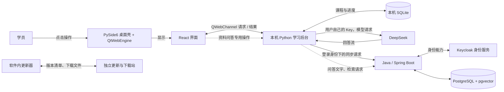

# 总架构：MentorFlow 的主要部分怎样协作

基线是仓库 `e61fd00d`：以下讲的是当前桌面版和线上服务。标题后的“常被问／偶尔问／基本不问”表示学习优先级判断，不是统计出来的面试频率。想象一间自习室：桌面窗口像前台，React 是办事屏，本机 Python 是老师和记账员，Java 服务是远处的校务办公室，更新站像独立的软件下载柜。比喻只帮助理解分工，真实系统靠程序接口、数据库和网络传数据，不会有真人跑腿。[A01]

## 1. 前台、办事屏和本机老师分工接待｜常被问

先把界面和本机后台接好。桌面程序用 PySide6 打开一个 QtWebEngine 窗口，窗口里的 React 页面负责菜单、课程卡片和课堂画面。[A02] **一句话层。**

页面要读本地课程或发起上课动作时，会通过 QWebChannel 把请求交给 Python；Python 做业务处理，再把结果或逐段回答送回页面显示。[A03] **三句话层。**

这像前台把填写好的办事单交给老师处理，处理结果再回到屏幕；但“办事单”只是比方，实际交接是有方法名、参数和返回消息的 JSON 请求，并不是网页能随便改后台文件。[A04] **深一层。**

图中的接口和存储说明的是程序关系，不表示每次点击都会访问所有盒子：普通课堂主要由本机 Python 和模型配合，Java 同步及资料检索是不同请求，更新器则走另一条服务链。[A05] 看到的都是窗口里的按钮，实际请求可能只走其中一条服务链。[A05]

你可以这样跟面试官说：软件打开后，PySide6 和 QtWebEngine 承载 React 页面。页面通过 QWebChannel 把操作交给本机 Python，Python 返回数据或回答流给界面。前端负责交互展示，学习规则和数据处理在 Python 侧。[A02][A03]

### 面试官问：桌面程序里前端和 Python 怎么配合？
- 桌面程序用 PySide6 打开一个 QtWebEngine 窗口，窗口里的 React 页面负责菜单、课程卡片和课堂画面。
- 页面要读本地课程或发起上课动作时，会通过 QWebChannel 把请求交给 Python；Python 做业务处理，再把结果或逐段回答送回页面显示。
- 实际交接是有方法名、参数和返回消息的 JSON 请求，并不是网页能随便改后台文件。

### 学习路线：本节出处
| 编号 | 具体说法 | 文件:行／条目／官方链接 |
| --- | --- | --- |
| A01 | 当前整体由桌面 PySide6、React、Python、DeepSeek、Java、Keycloak、PostgreSQL/pgvector 组成 | [ARCH-01]、[ARCH-02]、[ARCH-09]、[RAG-01]；`refactor/learning/web/package.json`；`refactor/server-java/pom.xml:4-16` |
| A02 | 单个 QtWebEngine 窗口承载 React 页面 | `refactor/learning/app/window.py:270-305`；[Qt for Python](https://doc.qt.io/qtforpython-6/) |
| A03 | 页面与 Python 通过 QWebChannel 请求、响应和事件通信 | `refactor/learning/app/bridge.py:130-228`；`refactor/learning/app/window.py:299-301`；[Qt WebChannel](https://doc.qt.io/qt-6/qtwebchannel-index.html) |
| A04 | 桥接层检查请求并把处理结果送回页面 | `refactor/learning/app/bridge.py:140-228` |
| A05 | 课堂、同步、资料问答与更新是不同的程序链路 | `refactor/learning/app/window.py:291-301`；`refactor/learning/app/classroom.py:208-271`；`refactor/learning/app/sync.py:104-153`；`refactor/learning/app/rag.py`；`refactor/desktop/delivery/update_service.py:28-45` |

## 2. 本机老师把课程和进度记在自己的账本里｜常被问

课程和进度先存本机账本。每个账号在本机有自己的 SQLite 课程库；它叫 `course.sqlite3`。[A06] **一句话层。**

Python 的课程服务读取计划、课程资料和当前进度，课堂规则也在本机执行；SQLite 保存这些学习记录，程序通过事务把一组相关改动一起写入。[A07] **三句话层。**

这像每个学员有自己的课程文件柜，老师在旁边记下做到哪一步；类比到此为止，SQLite 是嵌入软件的数据库文件，并非一个人在房间里，也不是服务器数据库。[A08] **深一层。**

需要联网时，同步服务会把符合同步规则的学习记录送往 Java 服务；同步暂时失败时，本机记录仍保留，后续可以重试。[A09] 原始资料文件仍留在本机，不会因为课程进度同步就自动上传。[A10]

你可以这样跟面试官说：课程和进度先由本机 Python 管理，保存在每个账号自己的 SQLite 文件里。这样课堂操作有本地数据基础；联网同步失败时，已保存的本机记录仍在，之后可以重试。原始资料文件不会随进度一起自动上传。[A06][A07][A09][A10]

### 面试官问：为什么课程数据先存在本机？
- 每个账号在本机有自己的 SQLite 课程库；它叫 `course.sqlite3`。
- SQLite 保存这些学习记录，程序通过事务把一组相关改动一起写入。
- 同步暂时失败时，本机记录仍保留，后续可以重试。

### 学习路线：本节出处
| 编号 | 具体说法 | 文件:行／条目／官方链接 |
| --- | --- | --- |
| A06 | 每个账号的课程库路径为 `course.sqlite3` | `refactor/learning/course/store.py:157-174`；`docs/project/CURRENT_STATE.md` `[ARCH-03]` |
| A07 | Python 服务提供课程存储，SQLite 写入使用事务 | `refactor/learning/app/services.py:18,86-90`；`refactor/learning/course/store.py:157-176,189-222` |
| A08 | 本机课程数据库与服务器数据库分开 | `docs/project/CURRENT_STATE.md` `[ARCH-03]` |
| A09 | 同步有独立服务，失败时保留本地记录 | `refactor/learning/app/sync.py:104-153,190-204`；[ARCH-03]、[ARCH-05] |
| A10 | 原始资料文件本地保存，不随同步上传 | `refactor/learning/app/rag.py:474-528,569-615`；[ARCH-03] |

## 3. 上一节课时，页面、模型和服务器怎样接力｜常被问

一堂课会走过几条数据链。课堂请求和进度同步各自处理，不会把整件事都交给服务器。[A11] **一句话层。**

学员点开当前小节，React 向 Python 请求课堂内容；Python 从本机课程数据取出要讲的内容，再把问题和所需上下文交给用户选定的模型。[A12] **三句话层。**

模型由客户端直接连接 DeepSeek，使用用户自己的 API Key；模型回答以文字流回到 Python，再显示在 React 页面。[A13] Java 不代替模型中转，也不负责生成每一堂课的回答。[A14] **深一层。**

课堂状态由本机宿主按照用户的操作推进并保存；模型生成讲解文本供老师展示，不直接改学习状态。[A15] 应同步的记录再交给同步服务。同步服务通过 HTTPS 访问 Java 后端；Java 的 Spring Boot 接口使用登录身份处理账号和同步业务，身份由 Keycloak 提供验证，业务数据保存在 PostgreSQL。[A16] Keycloak 负责确认“是谁在登录”，Java 负责按这个身份办理自己的业务；它不是课堂老师，也不替数据库保存课程表。[A26] 网络中断时，课堂本机记录不会因此消失；但服务器同步要等网络和登录状态恢复后再完成。[A17]

这好比老师现场讲课、学员自己的本子先记笔记，校务办公室之后收到需要共享的记录；比喻不意味着每句话都上传，模型回答和进度同步是两种单独的网络请求。[A18]

你可以这样跟面试官说：上一节课先由 React 把操作交给本机 Python。Python 取本地课程内容，用用户自己的 Key 直连 DeepSeek，再把回答显示给学员。宿主根据用户在课堂中的操作推进和保存进度，该同步的记录再由同步服务发给 Java；Keycloak 校验身份，Java 把业务数据写进 PostgreSQL。课堂请求和进度同步不是同一个请求。[A12][A13][A15][A16][A18]

### 面试官问：上一节课的数据经过哪些部分？
- React 向 Python 请求课堂内容；Python 从本机课程数据取出要讲的内容，再把问题和所需上下文交给用户选定的模型。
- 模型由客户端直接连接 DeepSeek，使用用户自己的 API Key；模型回答以文字流回到 Python，再显示在 React 页面。
- 课堂状态由本机宿主按照用户的操作推进并保存；模型生成讲解文本供老师展示，不直接改学习状态。
- 同步服务通过 HTTPS 访问 Java 后端；Java 的 Spring Boot 接口使用登录身份处理账号和同步业务，身份由 Keycloak 提供验证，业务数据保存在 PostgreSQL。

### 学习路线：本节出处
| 编号 | 具体说法 | 文件:行／条目／官方链接 |
| --- | --- | --- |
| A11 | 课堂本地处理与同步由不同组件负责 | `refactor/learning/app/classroom.py:208-271`；`refactor/learning/app/sync.py:104-153` |
| A12 | 桌面课堂操作经桥接进入本机学习服务 | `refactor/learning/app/handlers.py:278-285`；`refactor/learning/app/classroom.py:208-271,346-350,1862-1927` |
| A13 | 客户端 gateway 取出用户配置的凭据并调用模型 provider，DeepSeek 使用官方 API 地址 | `refactor/learning/connections/gateway.py:391-400,479,593-601`；`refactor/learning/connections/providers/registry.py:20-27`；`docs/project/CURRENT_STATE.md` `[SYS-02]`；[DeepSeek API](https://api-docs.deepseek.com/) |
| A14 | 用户选择的模型由客户端连接，Java 不中转 | `docs/project/CURRENT_STATE.md` `[ARCH-09]` |
| A15 | 课堂宿主按用户操作推进并保存状态；模型生成讲解文本，不直接改学习状态 | `refactor/learning/app/classroom.py:201-271,346-353,1378-1404`；`refactor/learning/course/store.py:189-222` |
| A16 | Java 服务使用 Spring Boot、OAuth 资源服务器和 PostgreSQL | `refactor/server-java/pom.xml:4-16`；`refactor/server-java/src/main/java/win/clannad/mentorflow/sync/SyncController.java:20-44`；`docs/project/CURRENT_STATE.md` `[ARCH-09]` |
| A17 | 同步失败时本地数据保留并可重试 | `refactor/learning/app/sync.py:104-153,190-204`；`refactor/learning/course/sync_course.py:508-560` |
| A18 | 同步与模型调用由独立网络组件执行 | `refactor/learning/app/sync.py:112-115`；`refactor/learning/connections/gateway.py:593-601`；`refactor/learning/connections/transport.py:63-79` |
| A26 | 登录身份由 Keycloak 验证，Java 接口以身份处理服务请求 | `refactor/server-java/src/main/java/win/clannad/mentorflow/identity/IdentitySecurity.java:42-45`；`docs/project/CURRENT_STATE.md` `[ARCH-09]` |

## 4. 资料问答和软件下载各走自己的门｜偶尔问

资料检索，软件更新分开。[A19] **一句话层。**

学员主动打开资料问答时，客户端把选中资料的文字分块送到 Java；Java 在服务器端为文字建立检索索引，按问题找出相关片段，再把片段交还客户端。[A20] 这些向量存放在 PostgreSQL 的 pgvector 扩展中，它只服务资料检索，不参与普通课堂进度记录。[A27] **三句话层。**

客户端仍用用户选择的模型和自己的 Key 生成回答；Java 负责存文字和找片段，不替模型写答案。资料问答会话保存在本机，上传的是文字，不是原文件。[A21] **深一层。**

软件更新走另一条链：桌面更新器向独立更新站检查版本清单、取回所需文件并验证签名，再准备安装；该过程不依赖课堂请求或 RAG 检索。[A22] 下载站还提供安装程序入口；截至本篇核验基线记录（2026-10-18），线上软件内更新已到 2.0.25，下载站安装程序仍是 2.0.15。[A23]

所以自习室里“把一段资料交给校务柜台查找”只对应资料问答，“换一套软件”只对应更新；两件事都不是普通上一节课的必经步骤。[A24]

你可以这样跟面试官说：平常上课不必先经过资料问答。只有用户打开资料问答时，文字才上传到 Java 做检索，回答仍由客户端的模型生成；软件更新又是独立的一条链，更新器从更新站拿清单和文件并验签。课堂、资料检索、软件更新各有自己的入口。[A19][A20][A21][A22]

### 面试官问：资料问答和课堂回答有什么区别？
- 资料检索，软件更新分开。
- 客户端把选中资料的文字分块送到 Java；Java 在服务器端为文字建立检索索引，按问题找出相关片段，再把片段交还客户端。
- Java 负责存文字和找片段，不替模型写答案。
- 软件更新走另一条链：桌面更新器向独立更新站检查版本清单、取回所需文件并验证签名，再准备安装；该过程不依赖课堂请求或 RAG 检索。

### 学习路线：本节出处
| 编号 | 具体说法 | 文件:行／条目／官方链接 |
| --- | --- | --- |
| A19 | 资料问答是独立页面和请求链路 | `docs/project/CURRENT_STATE.md` `[RAG-01]` |
| A20 | 客户端上传文字块，Java 侧检索 | `refactor/server-java/RAG_API.md:1-22,33-45`；`refactor/server-java/src/main/java/win/clannad/mentorflow/rag/RagController.java:14-39` |
| A21 | Java 只检索，不调用模型；客户端直连模型，问答会话本地保存 | `refactor/server-java/RAG_API.md:1-8`；`docs/project/CURRENT_STATE.md` `[RAG-01]` |
| A22 | 更新器读取签名清单、验证版本并下载文件 | `refactor/desktop/delivery/update_service.py:28-45,382,452-489`；`refactor/desktop/delivery/update_protocol.py:133-166` |
| A23 | 截至核验基线记录的线上版本与下载站安装程序版本 | `docs/project/CURRENT_STATE.md` `[SYS-06]` |
| A24 | 资料问答、课堂与软件更新各自使用单独请求链 | `refactor/learning/app/rag.py`；`refactor/learning/app/sync.py`；`refactor/desktop/delivery/update_service.py:28-45` |
| A27 | RAG 向量检索使用 pgvector，普通同步与课堂数据另走课程记录路径 | `docs/project/CURRENT_STATE.md` `[RAG-01]` `[ARCH-03]`；`refactor/server-java/RAG_API.md:45-60` |

## 学习路线：不用背｜基本不问

记住这些分工就够了：桌面壳显示 React，Python 在本机负责课程和进度，模型由客户端用用户自己的 Key 直连，Java 处理同步和资料检索，更新器单独联系更新站；要追某个按钮，再沿图里的箭头找专题，不必背类名。[A25]

### 学习路线：本节出处
| 编号 | 具体说法 | 文件:行／条目／官方链接 |
| --- | --- | --- |
| A25 | 当前组件职责与数据路径 | `docs/project/CURRENT_STATE.md` `[ARCH-01]` `[ARCH-02]` `[ARCH-03]` `[ARCH-09]` `[RAG-01]` `[SYS-06]` |
