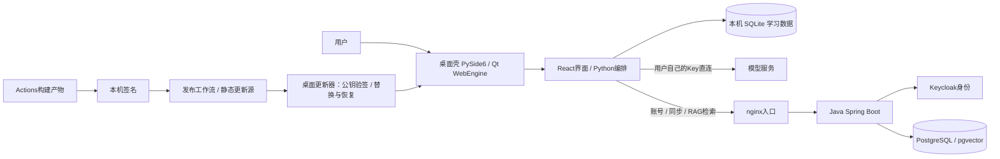

# 用 MentorFlow 学懂 MentorFlow：资料目录与落地设计

这是 161-MF07 的**课程设计和首份样章**，不是已经写完的整套教材。代码/项目事实冻结在 `958e7668`；课程份数、小时、优先级和学习顺序是本次方案的估算与判断，不是用户新定的目标。

用户要把副项目的要点先讲全，再深入值得追问的地方；基础按小白处理，不以读完所有源码为目标。讲述自己的真实职责：需求、取舍、组织 AI 实现、审查与验证分别做过什么，就说什么，不把生成的代码包装成亲手逐行实现。

## 先决定学什么：一张地图，两轮学习

**一句话层**先覆盖所有技术和流程：知道是什么，在哪用，为什么这里需要它。**三句话层**用“入口→关键处理→结果/失败”讲通。**深一层**只对 Java、AI/RAG、账号、同步、事务与两个代表性故障下钻；安装器 UI、批次号和杂项脚本只知道有这回事。

这里的“常被问/偶尔问/基本不问”是**复习优先级**。四份作者自述面经能支持“会沿简历里的模块继续追问”，不能推出副项目固定问几层或出现概率；所以本项目的标签都注明**判断**。JavaGuide 仅作主题覆盖参照，不把它的目录当面试统计。（依据见后面的公开出处。）

建议整套 **14 份课程资料 + 本页导航**，以下未写的文件是拟定任务名，不是坏链接；两份现成文件才可直接导入。

| 顺序/拟定文件 | 主题与要回答的问题 | 优先级（判断） | 预计学习小时 | 状态 |
|---|---|---|---:|---|
| 00-project-one-page.md | 产品解决什么问题；我的职责；一分钟口述；系统边界 | 常被问 | 0.25～0.5 | 待写 |
| 01-architecture.md | 桌面壳、React、Python编排、Java、Keycloak、数据库、模型直连、更新链路 | 常被问 | 0.5～1 | 待写 |
| [02-tech-stack.md](02-tech-stack.md) | 每样技术是什么、为什么采用、在哪里、追问一句；没比较过就明说 | 常被问；桌面细节偶尔 | 1.5～2 | 本批已写 |
| 03-create-plan.md | 上传/检索资料→认可→结构→知识点→备课；固定流程与模型的分工 | 偶尔问，AI岗位优先 | 0.75～1.25 | 待写 |
| [04-rag-from-upload-to-answer.md](04-rag-from-upload-to-answer.md) | 抽文字→分块→embedding→检索→重排→客户端回答与引用 | 常被问，Java+AI主亮点 | 1～1.5 | 本批完整样章 |
| 05-classroom.md | 课堂状态推进、原文讲义、资料原题、客观判分/问答自勾与记时 | 偶尔问 | 1～1.5 | 待写 |
| 06-sync.md | 本地出站→CAS→幂等→批量保存点→增量拉取→冲突与413 | 常被问 | 1.25～1.75 | 待写；可复用152稿 |
| 07-account.md | 登录、JWT与不透明令牌、刷新族、重放、挤下线、注销恢复 | 常被问 | 1.25～1.75 | 待写；可复用152稿 |
| 08-local-data-and-ledger.md | SQLite/WAL、事件与进度、冻结历史欠账、迁移不丢进度 | 偶尔问；事务边界常问 | 0.75～1.25 | 待写 |
| 09-release-and-update.md | Actions→构建→本机签名→发布→下载验签→替换/恢复；增量≠全量 | 偶尔问 | 1～1.5 | 待写 |
| 10-install-and-launch.md | PyInstaller与Inno的区别；安装位置、启动壳、登录窗和生命周期 | 基本不问细节；只背一段总览 | 0.25～0.5 | 待写，控制篇幅 |
| 11-decisions.md | ADR式解释：背景、用户定取舍、现方案、后果、未比较的方案 | 常被问 | 0.75～1.25 | 待写 |
| 12-bug-stories.md | 4个必讲STAR、2个备选；给真实证据，说明现在什么状态 | 常被问 | 1～1.5 | 待写 |
| 13-interview-check.md | 分层追问、每题参考要点、自查与不熟就回看的代码路径 | 常被问 | 1～1.5 | 待写 |

**总计估算约 12～19 小时**，包含口述和自测，不包括把所用库源码全读一遍；零基础概念需要反复时可能更久。第一轮铺开预计 3～5 小时，接着重点加深和看证据 7～11 小时，最后口述/自测 2～3 小时；这是按教材设计拆出的估算，不能保证“学完就不会被问住”。

**按学习日的顺序建议，不定死天数：**首个学习日先读00/01/02的一句话层，把全图连起来；之后每个学习日按可用时长拿一个主题包：先07+06，再04，再03+05+08，再09+10，最后11+12+13。某天时间少就拆包，时间多可合包；每天收尾用自己的话说“今天学的链路怎么走、一个失败怎么处理、我有什么证据”，不要求背同一句标准话。

## 先看系统总图（角色关系，不是全部部署容器清单）

资料问答的回答仍由客户端直连模型生成；服务器只找原文。软件更新走签名产物链，与课堂模型调用是两条链，不能把服务器迁Java说成整个软件都改Java。[CURRENT_STATE：ARCH-01、ARCH-09、RAG-01、SYS-06；具体技术与文件位置见02-tech-stack.md。]
## 每份资料的统一写法：像一堂课，不像类名清单

每份围绕少量连贯主题写 H2，主题里的三层用段末粗体标签（避免程序把标签截成小点名），不给“一句话/三句话/比喻”单独堆标题。H3 只留真实的小主题或问题式题目。大主题大小由内容决定，不为了凑分钟数或小要点数量切碎。[依据：CURRENT_STATE 的 BUG-104；当前程序行为另见下节。]

每个需要学习的主题包含：

- **一句话：**脱口而出，说清目的。
- **三句话：**起因、处理、结果，每句都能指回代码/决策。
- **深一层：**一段调用链或事务边界、一条真实失败、一个已验证数字；基础词先讲人话，再讲术语。
- **比喻：**给对应表和“不成立处”。例如借书目录可以比喻向量检索的候选，但不能说邻近等于答案正确。
- **频率/不用背：**常被问与偶尔问用判断或明确样本出处；基本不问只留一句，不生成背诵题。
- **题目：**问题式H3下面紧接3～5条参考要点，来自本节正文、保留出处；不要写答案空白让AI补。

ADR 写法只借“背景→决策→后果”的结构。为什么用 Java、为什么用户自己的 Key 直连、为什么资料原件不上服务器、为什么历史欠账冻结，都回到 CURRENT_STATE 的用户定条目。若没有记录 Spring Boot 相比其他框架的评测，就写“项目采用它，未找到对比证据”，不能补造一场技术选型。[依据：ARCH-09、DATA-02、BUG-16、BUG-83、RAG-01。]

## 怎么放进软件：本地 Markdown 建计划为主，RAG 作查阅

| 路线 | 当前能力/限制 | 建议 |
|---|---|---|
| 本地 Markdown 文件上传建计划 | 现有 `materials.import_file` 能导入MD，抽出原文块和标题路径，再进入现有计划流程；可用本机生成、审核后的资料 | **首选。**只导入课程正文，按阶段上传，不把本导航、报告、源码清单混入课程 |
| GitHub 仓库导入 | `github_repo.import_repo` 使用公开 GitHub API/原始文件地址，筛选Markdown，没有传私有仓库凭证的入口，不导Python/Java源码 | **不作为当前私库路线。**本任务不开放仓库、不接令牌、不向第三方wiki发送私库；从本地受控资料上传即可 |
| 资料问答 | 能直接上传文字资料、不建计划，按所选资料检索并直连模型回答，引用可点回原文；会话本机保存 | **补充。**把已审教材放进去做“这处事务在哪、为什么这样选”的随身查阅，不代替按计划学习/自测 |

代码依据：`refactor/learning/course/materials.py:141-170`；`course/github_repo.py:174-201,205-244`（公开获取、Markdown筛选）；`app/rag.py:569-615,639-700`；CURRENT_STATE[RAG-01]。三条路线不需要新增产品功能。

### 标题不是装饰：真实切点读的是哪些信息

Markdown 提取器保留 `#` 层级形成 section 路径，正文以约1200字目标、2000字上限分存储块；这些是传输/存储边界，不等于用户应学的主题。[`course/extract.py:286-322,869-891`]

当前建计划在认可结构后，选模块资料块、保留来源和 `block_fragments`，调用 `directory_plan_module`；它先判断原文小节属于知识还是导航，再按当前目录/块归属规则生成大点和小点，讲义在准备阶段补。[`app/plan_flow.py:1056-1092,1695-1700`；`course/planner_agents.py:1402-1447,1449-1546,1601-1648,1698-1736`]

**不能承诺 H2 必然一对一变成大点。**在本基线中，正文块归属于其首个原文标题，小节可能按同父目录与估时合并，子组也有调整规则；它不是“给任意小标题就会自动理解语义”。因此要让 H2 自己就是完整主题，少用无意义标题，正文、比喻、例子不要散到文末；原文题紧跟主题，试切后再判断是否需要改资料结构。BUG-104 是用户要主题连贯的要求，不能把该要求当成任意输入下已经自动达成的保证。[同上函数；CURRENT_STATE[BUG-104]]

样章的离线预检已发现：行内粗体“问/参考答案”会得到5个不理想的候选，整节正文被混入超长题干。改成独立问题式H3+参考要点后，真实导入得到15个原文块和6个正确题干；最终修订稿实际导入16个原文块，真实试切为4大点/6小点/5导航、46分钟估时；6个小点都有讲义摘句，6道问答逐字编译入库并重开读到。首轮默认30秒首事件等待超时，最终隔离夹具用120秒完成，不代表产品默认策略已改。实际大点仍多为问题式标题，第三点并列三问，小点还有首句截断，扩写前应再试短而完整的主题首句。完整结果、已知费用和未知尾笔上界见本批报告；这里只修资料写法，没有改识题算法。[161-MF07 隔离导入记录，汇总于 report.md]

## 先做什么、怎么并行、怎样才算完成

**先写资料，轻量入口澄清可以并行；不等仓库大扫除。**文档入口/生命周期标注收益高；重命名目录、搬迁测试、删除旧服务器会牵动构建/回退，不应挡住学习。本任务只有建议，没做清理。

| 工作包/建议分工 | 独占文档 | 验收要点 |
|---|---|---|
| A 产品与总架构作者 | 00、01、11 | 一分钟口述+2层自绘图；每个用户定决策原出处；不虚构选型 |
| B Java/数据作者 | 06、07、08 | 请求链路、CAS/幂等/事务/会话/账本；至少正常、失败、重试3场景证据；可复用152稿但更新现状态 |
| C AI/学习作者 | 03、04、05 | 原文、模型、程序各做什么；真实问答题和参考要点；主题不机械碎切 |
| D 桌面/发版作者 | 09、10 | 更新签名/下载/替换/回退、安装启动边界；私钥只讲角色不展示；低频细节不背 |
| E 独立核对与练习编辑 | 02、12、13和全套核对清单 | 核对代码/官方来源、比喻、BUG数据与现状态；作者不能自己签最终通过 |

这些是**建议任务拆分**，不是已派任务；5个包可以由不同人并行，A负责公共术语，E统一证据审查，文件互不重叠。最先有价值的是00/01/02+04，接着06/07，再写2个STAR和自测；其他随后补齐。已交付02和04，不等其余12份才开始学。

### 每份的完成标准

1. 每句项目事实都有稳定基线 + 文件:行/符号或 CURRENT_STATE 条目；概念定义另引官方文档，判断与估算显式标注。
2. 读者能讲出一句话/三句话；重点主题有深一层证据；无低频背诵负担。
3. 独立核对员逐句查源码、状态、数字、比喻边界，发现问题先改文再签表。
4. MD离线导入检查标题、片段、题干/完整答案；至少一次现有切点链路试切，保留输入sha和结果、费用。
5. 题库来自明确原题，程序逐字校验；抽查引用能回到原文，题外细节不进要点；不靠AI补题。
6. 教材与技术栈/决策/BUG稿没有矛盾；已知小问题写现状态，不把“已实现”当用户验收。

### 以后代码改了，资料怎么不掉队（设计，不新增脚本）

建议每条事实分配claim_id，记录文档句子、代码commit、path、symbol、起止行、片段sha、CURRENT_STATE条目或官方URL、作者/核对员/日期。发版检查先确认文件存在和行号范围，再在指定符号内寻找片段并比较sha；移动行号只报位置变化，内容变更标“需人工重核”，不能只因行号还在就算通过。检查只读，不执行源码，也不触发模型。

事实变更按文件反向索引只重核受影响章节；外部概念/价格标核对日。若源码变了而教材没复核，课程包保持旧版本并注明，不静默换成不匹配的“最新版”。自动检查只能发现漂移，不能证明一个句子的含义正确，最终仍要独立人/代理逐句核对。这是方案，不在本任务添加程序或CI。

## 不用背：副项目的精力花在这里才值

不背框架全部类名、ONNX底层算子、HNSW调参表、量化数学证明、每个错误码/SQL列名、Actions运行编号、临时容器名/端口、安装器控件坐标、批次号脚本、111条BUG全文。知道“在哪查”即可。签名与加密的区别、检索与生成的区别、事务与保存点、为什么不会重复记进度，这些仍值得讲清。

已知小问题的讲法：基线中资料问答待用户亲测；邮件类账号流程线上尚未真人走全；更新框裁切/后台下载撞锁提示（BUG-110/111）待修。前两项说明验证边界，后两项知道现象和状态就够，不把未查明原因说成已修；都不应抢占副项目主线。[CURRENT_STATE[RAG-01,ACC-02,BUG-110,BUG-111]，基线958e7668]

## 查到的做法和面经：怎么用，哪里不能外推

- [arc42](https://arc42.org/)：借目标、约束、场景和决策的组织思路；不复制模板、不要求填满。许可说明见[官方FAQ](https://faq.arc42.org/questions/A-2/)（模板CC BY-SA 4.0；本项目自写内容不因采用其组织思路变同许可）。
- [C4](https://c4model.com/)：借系统上下文/容器两层自绘图，必要时关键流程动态图；不画全部类图。官方站和示例图CC BY 4.0，本任务不复制图。
- [ADR](https://github.com/architecture-decision-record/architecture-decision-record)：借背景/决策/结果；不编未发生的备选讨论，不拷模板正文。
- [Diátaxis](https://diataxis.fr/)：学习教程、操作指南、事实查表、原因解释分开；不机械建四个空目录。仅参考概念、不复制原文，未核到可复用授权。
- [DeepWiki 官方说明](https://github.com/CognitionAI/deepwiki)、[私库入口](https://deepwiki.com/private-repo)：参考“可导航的仓库百科”形态；私库接入依赖其服务/账号，当前不使用，不把生成内容当事实源，不上传本项目代码。服务内容许可未核实。
- [CodeTour](https://github.com/microsoft/codetour)：参考文件/行的导览步骤，将“入口→关键函数→结果”做成人能读的路线；不引插件依赖，也不假设行号不变。源码MIT，本任务只参考结构。
- [STAR 官方就业指导](https://nationalcareers.service.gov.uk/careers-advice/interview-advice/the-star-method)：把BUG讲成场景/任务/行动/结果；不编用户量、效率提升或职责。
- 四份定性面经：[得物项目挑战/取舍/验证](https://www.nowcoder.com/discuss/925044292312117248)、[字节AI项目完整链路](https://www.nowcoder.com/feed/main/detail/be69b43160d04dbdba25d72d09f31a1c)、[字节框架/表设计](https://www.nowcoder.com/discuss/353158677181964288)、[广联达登录session](https://www.nowcoder.com/discuss/353156456432214016)。作者自述、岗位/年代不同、有投稿偏差；只支持从功能往动机/机制/验证追问的准备策略，不支持“副项目只问一层”。
- [JavaGuide](https://github.com/Snailclimb/JavaGuide)：参照常见Java/数据库/框架主题，题库目录不是概率统计；不复制题目答案，本项目问答来自本项目核实事实。

研究日期2026-10-18。详细仓库体检、样章逐句核对、比喻审查、试切与花费见 `D:/MentorFlow/.local/test-tmp/learn161/report.md`。